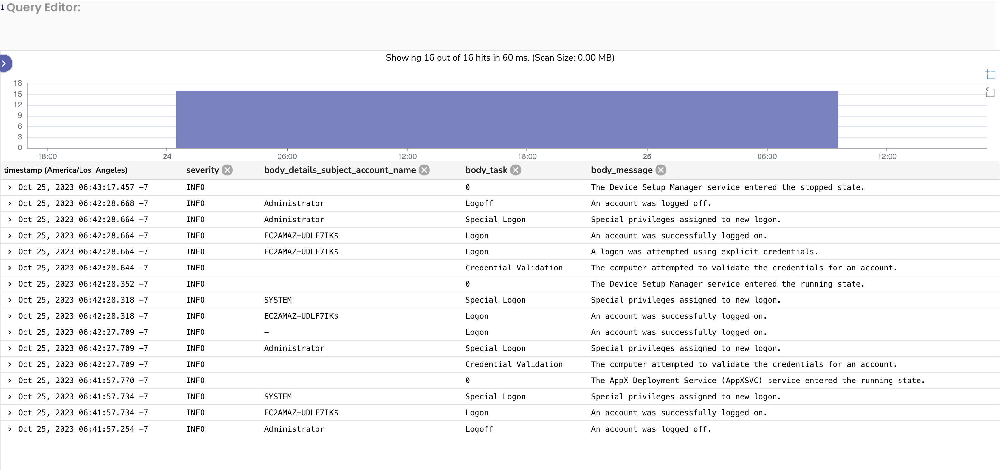

# Agents

Scripts that configure and install the Open Observe agent on various platforms.

The Linux and Windows scripts work on plain hosts and auto-detect AWS EC2, GCP Compute
Engine and Azure VMs, adding cloud resource attributes. On EC2, `host.name` is set from
the instance `Name` tag when the instance has an IAM role with `ec2:DescribeTags` and
can reach the EC2 API; otherwise `host.name` is the OS hostname.

## Linux

### Install

```bash
wget https://raw.githubusercontent.com/openobserve/agents/main/linux/install.sh && chmod +x install.sh && sudo ./install.sh {URL} {authorization_token}
```

e.g.

```bash
wget https://raw.githubusercontent.com/openobserve/agents/main/linux/install.sh && chmod +x install.sh && sudo ./install.sh https://api.openobserve.com/api/your_org/ cm9vdEBleGFtcGxlLmNvbTpDb21wbGV4cGFzcyMxMjM=
```

### Tracing (optional)

Add `--trace-*` flags to also trace selected processes with eBPF, without code
changes. This runs the collector as root and needs Linux 5.8+ (or RHEL-family
4.18) with BTF. If the host can't run it, the install fails without touching the
running collector. If tracing fails right after the collector restarts, the install
stops and disables the collector (logs and metrics too) and exits with an error;
re-run without the flags to recover.

```bash
sudo ./install.sh {URL} {authorization_token} --trace-ports 8080
sudo ./install.sh {URL} {authorization_token} --trace-exe '/opt/checkout/*' --service-name checkout
```

`--trace-ports` takes ports and ranges; `--trace-exe` (executable path) and
`--trace-cmd` (command line) take globs. All three can be repeated. `--service-name`
reports every traced process under one name. Traced processes add a W3C
`traceparent` header to their outgoing plain-text HTTP requests, so traces continue
across hosts. Re-run without the flags to turn tracing off. See [obi.md](obi.md)
for details.

### Uninstall

```bash
wget https://raw.githubusercontent.com/openobserve/agents/main/linux/uninstall.sh && chmod +x uninstall.sh && sudo ./uninstall.sh
```

## Mac OS X

Collects host metrics, log files from the standard macOS locations, and the macOS
unified log. See [mac/README.md](mac/README.md) for details and tuning.

### Install

macOS does not ship `wget`, so these use `curl`.

```bash
curl -O https://raw.githubusercontent.com/openobserve/agents/main/mac/install.sh && chmod +x install.sh && sudo ./install.sh {URL} {authorization_token}
```

e.g.

```bash
curl -O https://raw.githubusercontent.com/openobserve/agents/main/mac/install.sh && chmod +x install.sh && sudo ./install.sh https://api.openobserve.com/api/your_org/ cm9vdEBleGFtcGxlLmNvbTpDb21wbGV4cGFzcyMxMjM=
```

### Uninstall

```bash
curl -O https://raw.githubusercontent.com/openobserve/agents/main/mac/uninstall.sh && chmod +x uninstall.sh && sudo ./uninstall.sh
```

## Windows

### Install

Requires Windows 10 1803+ or Windows Server 2019+ (for the built-in `tar`). From powershell terminal:

```powershell
Invoke-WebRequest -Uri https://raw.githubusercontent.com/openobserve/agents/main/windows/install.ps1 -OutFile install.ps1 ; .\install.ps1 -URL <URL> -AUTH_KEY <Authorization_Key>
```

e.g.

```powershell
Invoke-WebRequest -Uri https://raw.githubusercontent.com/openobserve/agents/main/windows/install.ps1 -OutFile install.ps1 ; .\install.ps1 -URL http://localhost:5080/api/default -AUTH_KEY cm9vdEBowWjJSanhscWtSbVB5S0VE
```

The script installs and starts the `otel-collector` Windows service.



### Uninstall

```powershell
Invoke-WebRequest -Uri https://raw.githubusercontent.com/openobserve/agents/main/windows/uninstall.ps1 -OutFile uninstall.ps1 ; .\uninstall.ps1
```

